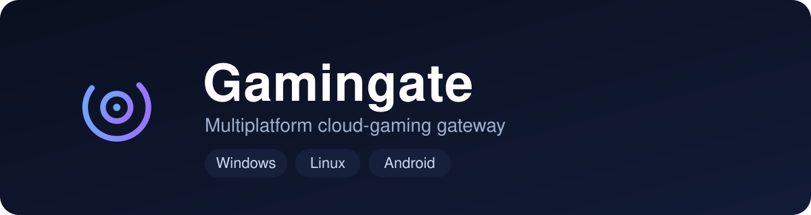

<p align="center">
  
</p>

<p align="center"><em>Sign in once, stream anywhere.</em></p>

<p align="center">
  <a href="https://github.com/Chazyl/Gamingate/actions/workflows/ci.yml"></a>
  <a href="LICENSE"></a>
  
  <a href="https://github.com/Chazyl/Gamingate/releases"></a>
</p>

Gamingate is an open, registry-driven **cloud-gaming gateway**. It embeds cloud-gaming
web apps — starting with **Amazon Luna** — inside isolated, privileged containers, so
you get a native-feeling app instead of a browser tab. Providers can't be framed
(`X-Frame-Options`/CSP), so Gamingate loads them top-level in their own session
partition under a trusted shell: **no iframe, no browser extension, no plugin.**

Adding a provider is a `platforms.json` entry, not engine work.

## Features

- **Isolated provider sessions** — each provider runs in its own `persist:<id>`
  partition, so you stay signed in without the gateway ever touching credentials.
- **Trusted-IPC boundary** — provider content is sandboxed with an inert preload;
  only the shell can reach privileged, sender-allowlisted IPC handlers.
- **Registry-driven** — `platforms.json` (validated by a shared schema on desktop
  *and* Android) declares entry URL, allowed origins, user agent, permissions, and
  header rules.
- **Real input** — gamepad, pointer lock, and focus retention for playable sessions.
- **Honest diagnostics** — a stream-health overlay reports what the runtime actually
  exposes (Widevine L3), never fabricated numbers.
- **Decode control** — toggle hardware decode; the choice persists and applies on
  relaunch.
- **Cross-OS** — a per-packet platform spoof lets providers that only whitelist
  Windows run on Linux.
- **Packaged** — Linux AppImage + `.deb`, Windows `nsis`, and a signed Android APK.

## Platforms

| Platform | Format | Status |
|----------|--------|--------|
| **Linux** | `.AppImage`, `.deb` | ✅ Validated end-to-end (signed in and played on Ubuntu 24.04) |
| **Windows** | `.exe` (nsis) | Packaging configured; installer + production signing pending |
| **Android** | `.apk` | Built and signed (L3 WebView); physical-device validation pending |

## How it works

Each provider is a **top-level `WebContentsView`** on its own partition, composed by
a trusted shell in a `BaseWindow`:

```
BaseWindow.contentView
├── shellView      trusted React chrome — service picker / settings / status
│                  preload bridge to ipcMain (privileged)
├── providerView   provider web app, top-level
│                  own persist:<id> partition, INERT preload (no bridge)
└── overlayView    trusted, transparent, on demand — stream health
```

Auth happens on the provider's own origin; the resulting session jar persists in
`persist:<id>`. The gateway never receives credentials and never transplants
sessions. See [docs/ARCHITECTURE.md](docs/ARCHITECTURE.md) for the details.

## Quick start

### Linux

```bash
# Debian / Ubuntu (recommended)
sudo apt install ./Gamingate-1.0.0-amd64.deb

# AppImage (needs libfuse2 on Ubuntu 24.04 / Debian 13+)
chmod +x Gamingate-1.0.0-x86_64.AppImage
./Gamingate-1.0.0-x86_64.AppImage
```

### Android

```bash
adb install -r gamingate-android-release.apk
```

### Windows

The installer is configured but not yet published; see
[docs/SIGNING.md](docs/SIGNING.md) for the signing requirements.

Then pick **Amazon Luna**, sign in on Luna's own page, and launch a game.

## Build from source

Everything builds and tests in **Docker** — nothing is installed on the host.

```bash
bash desktop/scripts/docker-verify.sh typecheck
bash desktop/scripts/docker-verify.sh test

# packages -> desktop/dist/ and android/dist/
bash desktop/scripts/docker-verify.sh package-appimage
bash desktop/scripts/docker-verify.sh package-android
```

Full instructions (smoke tests, session/decode probes, dev helpers, troubleshooting)
are in [docs/BUILDING.md](docs/BUILDING.md).

## Repository layout

| Path | What |
|------|------|
| [`desktop/`](desktop/) | Electron (castlabs ECS) shell + engine, `platforms.json`, container harness |
| [`android/`](android/) | Bare-Kotlin system-WebView shell + registry validator |
| [`packaging/`](packaging/) | Packaging index and artifact map |
| [`branding/`](branding/) | Logo/icon source |
| [`docs/`](docs/) | Architecture, building, release matrix, signing, CI, performance |
| [`.github/`](.github/) | CI workflows, issue/PR templates, dependency updates |

## Documentation

- [Architecture](docs/ARCHITECTURE.md)
- [Building & testing](docs/BUILDING.md)
- [Platform matrix](docs/RELEASE-MATRIX.md)
- [Packaging](docs/packaging.md) · [Signing](docs/SIGNING.md) · [CI](docs/CI.md)
- [Performance](docs/PERF-02-cold-start.md)

## Contributing

Contributions are welcome. Read [CONTRIBUTING.md](CONTRIBUTING.md) and the
[Code of Conduct](CODE_OF_CONDUCT.md) first. For security issues, see
[SECURITY.md](SECURITY.md) — please do not open a public issue.

## License

[Apache License 2.0](LICENSE). See [NOTICE](NOTICE) for third-party components.

## Acknowledgements

- [castlabs Electron (ECS)](https://github.com/castlabs/electron-releases) for a
  Widevine-capable Electron runtime.
- [Electron](https://www.electronjs.org/) and [Chromium](https://www.chromium.org/).
- Inspired by the organisation and spirit of
  [Sunshine](https://github.com/LizardByte/Sunshine) and
  [Moonlight](https://github.com/moonlight-stream).

Gamingate is an independent, unofficial project. It is not affiliated with Amazon,
Luna, Google, castlabs, or any cloud-gaming provider.
